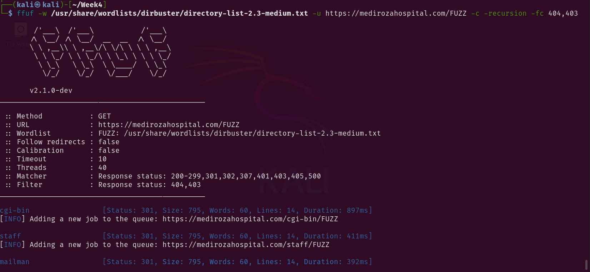
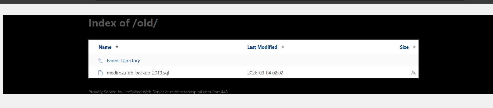
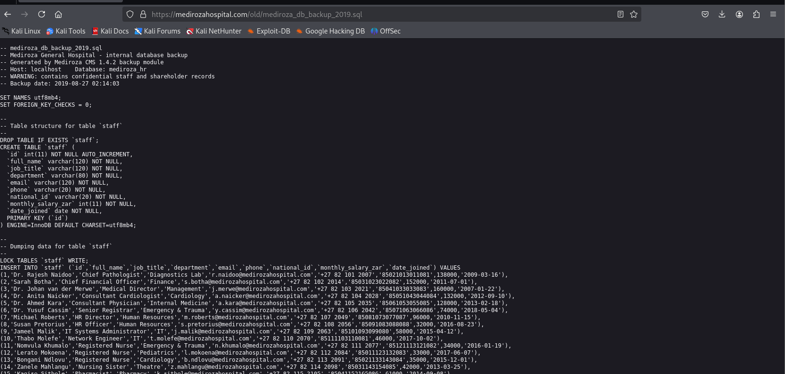
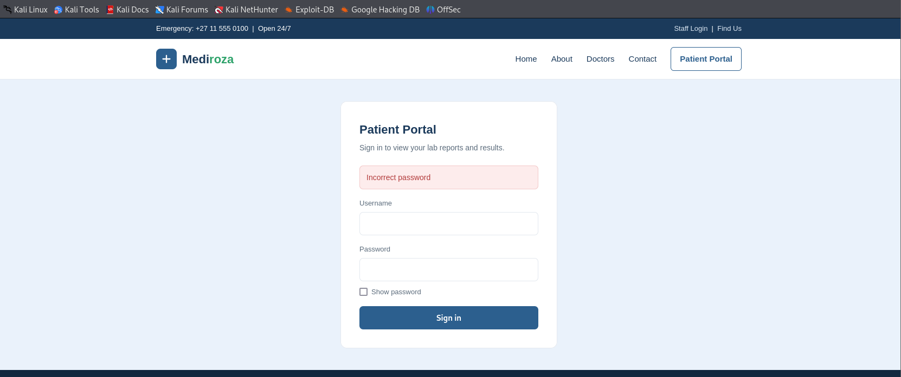
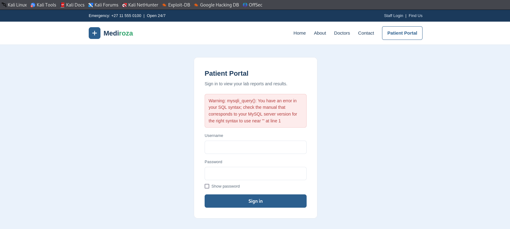
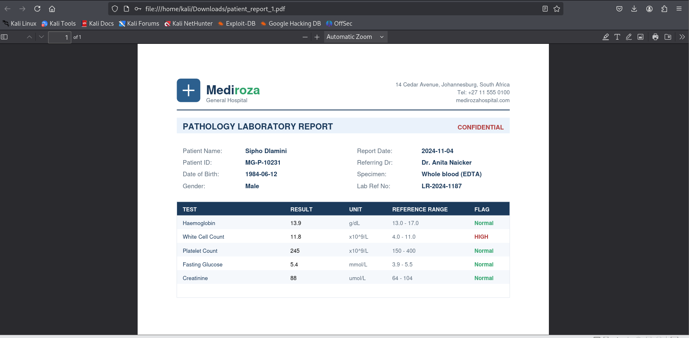

# Mediroza-General-Hospital-Penetration-Testing-Week-4

<p align="center">
  <b>Black-Box Web Application Penetration Testing</b><br>
  NetworkWalks | B084 | Week 04
</p>

<p align="center">
  
  
  
  
</p>

---

## About This Project

This repository contains my notes, findings, and evidence from a practical web application penetration testing assessment conducted against **Mediroza General Hospital** as part of the NetworkWalks B084 training program.

The assessment was approached as a Black-Box test. I started with what was publicly available, explored the application, and followed each interesting discovery to see where it would lead.

The main focus was on application security, authentication, and the protection of sensitive files.

| Detail | Value |
|---|---|
| Target | `medirozahospital.com` |
| Organization | Mediroza General Hospital |
| Assessment | Black-Box Web Application Pentest |
| Training | NetworkWalks |
| Cohort | B084 |
| Week | 04 |
| Duration | 5 Days |

> **Disclaimer:** This repository is intended for authorized educational documentation. No patient records, credentials, passwords, or confidential database contents are published here.

---

## Table of Contents

- [Scope](#scope)
- [Tools](#tools)
- [01 - Reconnaissance](#01---reconnaissance)
- [02 - Information Disclosure](#02---information-disclosure)
- [03 - Authentication Testing](#03---authentication-testing)
- [04 - SQL Injection](#04---sql-injection)
- [05 - Confidential Reports](#05---confidential-reports)
- [06 - PDF Password Recovery](#06---pdf-password-recovery)
- [Findings Summary](#findings-summary)
- [Recommendations](#recommendations)
- [Conclusion](#conclusion)

---

## Scope

The assessment was limited to the following target:

`medirozahospital.com`

The following restrictions applied throughout the assessment:

- No Social Engineering.
- No Denial of Service attacks.
- No testing outside the agreed scope.
- Findings must remain private until the official Reveal Session.

---

## Tools

These are the main tools I used during this part of the assessment.

| Tool | Usage |
|---|---|
| [FFUF](https://github.com/ffuf/ffuf) | Directory and file enumeration |
| [PDFCrack](https://github.com/robins/pdfcrack) | Offline PDF password recovery |
| RockYou | Password wordlist |
| cURL | Inspecting accessible web resources |
| Browser | Manual application testing |

---

# 01 - Reconnaissance

### 1.1 Directory Enumeration

I started with directory enumeration using FFUF to get a better picture of the application's publicly accessible resources.

The goal was simple: find paths that were not immediately visible through normal website navigation.

**Command:**

```bash
ffuf -w /usr/share/wordlists/dirbuster/directory-list-2.3-medium.txt -u https://medirozahospital.com/FUZZ -c -recursion -fc 404,403
```

The scan revealed several interesting paths. Two discoveries caught my attention:

- `robots.txt`
- A directory named `old`

The second discovery was worth investigating further.

**Evidence:**



*Figure 01 – FFUF results showing discovered paths.*

### 1.2 Checking robots.txt

I also checked `robots.txt` to see whether the website referenced any additional paths.

```bash
curl -s https://medirozahospital.com/robots.txt
```

This was part of the initial information-gathering process.

**Evidence:**


*Figure 02 – robots.txt inspection.*

---

# 02 - Information Disclosure

### 2.1 The old Directory

I decided to investigate the `old` directory discovered during enumeration.

It turned out to be more interesting than expected: the directory contained an old database backup.

**Evidence:**



*Figure 03 – The discovered old directory.*

### 2.2 Database Backup

Further inspection of the backup revealed records related to hospital employees and shareholders.

This was an important finding. A database backup should not be directly accessible through a public web directory, especially when it contains internal organizational information.

**Evidence:**



*Figure 04 – Exposed database backup. Sensitive information has been redacted.*

**What made this interesting?**

The backup provided access to information that should have remained restricted to authorized personnel.

---

# 03 - Authentication Testing

### 3.1 Testing the Login Page

After the initial reconnaissance, I moved to the login page to examine how the application handled authentication errors.

I started with a simple invalid username and password:

`test / test`

The application responded that the username did not exist.

Next, I tried the administrative username with an incorrect password. This time, the response was different: the application indicated that the password was incorrect.

| Test | Response |
|---|---|
| Invalid username | Username does not exist |
| Existing username, wrong password | Incorrect password |

This difference revealed something useful: the application was disclosing whether a username existed.

This is known as **Username Enumeration**.

**Evidence:**



*Figure 05 – Different responses from the login page.*

---

# 04 - SQL Injection

### 4.1 Identifying MySQL

While examining the login form, I tested how the application handled unexpected input.

One of the responses was particularly interesting: instead of returning a normal authentication message, the application displayed a database-related error.

The error exposed information about the backend technology and indicated that the application was using **MySQL**.

**Evidence:**



*Figure 06 – Database error revealing MySQL.*

### 4.2 Authentication Bypass

The database error suggested that user input was being handled unsafely.

Further testing confirmed that the login mechanism was vulnerable to SQL Injection. I was able to bypass authentication and reach a restricted page without completing the normal login process.

This was a major turning point in the assessment because it opened access to functionality that was not publicly available.

**Vulnerability:** SQL Injection – Authentication Bypass

**Evidence:**

[Insert authentication bypass screenshot here]

### Why it matters

An authentication bypass can expose restricted application functionality to users who have not been properly authenticated.

In this case, it also led to the discovery of confidential laboratory reports.

---

# 05 - Confidential Reports

After gaining access to the restricted page, I found three laboratory reports in PDF format.

All three files were password-protected.

| Item | Result |
|---|---|
| Restricted page | Accessible |
| PDF reports discovered | 3 |
| Password protection | Enabled |
| Document access | Not yet verified at this stage |

**Evidence:**


*Figure 07 – Three protected laboratory reports.*

The next step was to examine the PDF protection itself.

---

# 06 - PDF Password Recovery

### 6.1 Working with PDFCrack

I used PDFCrack to test the password strength of the three recovered documents.

For this step, I used the RockYou wordlist and performed the recovery offline.

**Commands:**

```bash
pdfcrack -w /usr/share/wordlists/rockyou.txt patient_report_1.pdf

pdfcrack -w /usr/share/wordlists/rockyou.txt patient_report_2.pdf

pdfcrack -w /usr/share/wordlists/rockyou.txt patient_report_3.pdf
```

### 6.2 Results

The recovery process was successful for all three documents.

| Document | Recovery Result |
|---|---|
| Patient Report 01 | Successful |
| Patient Report 02 | Successful |
| Patient Report 03 | Successful |

**Evidence:**


*Figure 08 – PDF password recovery results. Passwords are hidden.*

### 6.3 Verifying Document Access

After recovering the passwords, I opened each document to verify that the files could be accessed.

This confirmed that the password protection did not prevent access once the passwords were recovered.

**Evidence:**



*Figure 09 – Successful PDF access. Patient information is redacted.*

---

# Findings Summary

Here is a summary of the issues identified so far.

| ID | Finding | Category | Preliminary Severity |
|---|---|---|---|
| NW-01 | Exposed Database Backup | Information Disclosure | Critical |
| NW-02 | Username Enumeration | Authentication Weakness | Medium |
| NW-03 | SQL Injection | Injection | Critical |
| NW-04 | Authentication Bypass | Authentication | Critical |
| NW-05 | Unauthorized Access to Laboratory Reports | Broken Access Control | Critical |
| NW-06 | Weak PDF Passwords | Password Security | High |

*Severity levels are preliminary and subject to final impact assessment.*

---

# Recommendations

Based on the findings, the following changes should be considered:

| Finding | Recommended Action |
|---|---|
| Exposed Backup | Move backups outside the public web directory and restrict access. |
| Username Enumeration | Return generic login error messages. |
| SQL Injection | Use prepared statements and parameterized queries. |
| Authentication Bypass | Review authentication logic and enforce secure server-side validation. |
| Confidential Reports | Apply authorization checks to every document request. |
| Weak PDF Passwords | Use strong, unique passwords and modern encryption. |

Additional recommendations:

- Review server access logs for suspicious activity.
- Apply the principle of least privilege to database accounts.
- Ensure sensitive files are not accessible through predictable URLs.
- Conduct a follow-up security assessment after remediation.

---

# Conclusion

This assessment started with a simple directory scan and gradually led to several important discoveries.

The most significant part was how the findings connected: an exposed backup revealed internal information, authentication testing uncovered weaknesses in the login process, and the SQL Injection vulnerability led to a restricted page containing confidential reports.

The three PDF files were also successfully accessed after recovering their passwords using PDFCrack.

There is still more to investigate, particularly regarding the full extent of the exposed organizational information. Additional findings will be documented as the assessment progresses.

---

## References

- [FFUF – GitHub](https://github.com/ffuf/ffuf)
- [PDFCrack – GitHub](https://github.com/robins/pdfcrack)
- [OWASP Web Security Testing Guide](https://owasp.org/www-project-web-security-testing-guide/)
- [OWASP SQL Injection Prevention Cheat Sheet](https://cheatsheetseries.owasp.org/cheatsheets/SQL_Injection_Prevention_Cheat_Sheet.html)
- [CWE-89 – SQL Injection](https://cwe.mitre.org/data/definitions/89.html)
- [CWE-200 – Exposure of Sensitive Information](https://cwe.mitre.org/data/definitions/200.html)

---

<p align="center">
  <b>NetworkWalks | B084</b><br>
  Week 04 – Practical Penetration Testing
</p>
